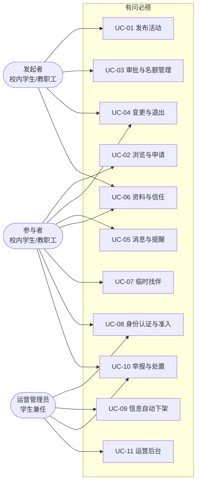

# 有问必“搭”软件需求规格说明书（SRS）

- 版本：v0.2 草稿（待评审）
- 日期：2026-11-25
- 对应课程：第 03 课 · 第 11 周 · SRS 定稿
- 状态：**草稿**，评审通过后升 v1.0 并以 Release 发布

| 版本 | 日期 | 修订人 | 说明 |
|---|---|---|---|
| v0.1 | 2026-11-25 | 组长 | 初稿：11 个用例 + 29 条需求 + 非功能 + 追溯矩阵 |
| v0.2 | 2026-11-25 | 组长 | 删除场地方/资源提供方角色；认证方式改为同济大学统一身份认证；用户范围限定为校内学生与教职工 |
| v1.0 | — | — | 评审通过后发布 |

---

## 1. 引言

### 1.1 目的

本文规定"有问必搭"（Ask.Match）的功能需求、非功能需求与约束条件，作为设计、开发、测试与验收的依据。读者为课程评审教师、开发组成员与测试负责人。

### 1.2 范围

本产品面向**同济大学校内学生与教职工**，通过学校统一身份认证准入，解决"**熟人凑不齐、又不想放弃这次活动**"这一具体时刻的找人问题，覆盖发布、发现、申请、确认、变更、通知、资料可见与运营治理八个方面。

**不在范围内**（详见 `非目标与边界.md`）：

- 校外用户注册与使用（统一身份认证天然限定为校内人员）
- 约会 / 陌生人配对
- 付费会员与增值订阅
- 自动定位与持续位置共享
- 场地预订、拼车交易等资源撮合（本产品只解决"找到人"，不介入"订资源"）
- 人工全量内容审核

### 1.3 术语与缩写

| 术语 | 含义 |
|---|---|
| 搭子 | 为某次具体活动临时结成的同伴关系，非长期社交关系 |
| 发起者 | 创建活动、审批申请、管理名额的校内用户 |
| 参与者 | 浏览活动、提交申请、确认参加的校内用户 |
| 运营管理员 | 由学生担任，负责举报处理与信息治理，无专职人力 |
| 统一身份认证 | 同济大学校园统一身份认证（SSO），返回学号/工号与身份类型 |
| 确认状态机 | 已提交 → 已接受 → 已确认 →（已到场 / 已付费） |
| EV | 调研证据编号，格式 `EV-S05-Q07` 或 `EV-O01-Q1` |
| US / NFR | 用户故事编号 / 非功能需求编号 |
| UC / TC | 用例编号 / 测试用例编号 |
| P0 / P1 / P2 | 优先级：不做不能答辩 / 本轮要做 / 可选或待验证 |

### 1.4 参考资料

| 文档 | 位置 | 用途 |
|---|---|---|
| 调研回答整理（S01–S04） | `doc/调研报告/有问必搭_调研回答整理.md` | 学生访谈原始证据 |
| 调研回答整理（S05–S09） | `doc/调研报告/有问必搭_调研回答整理_S05-S09.md` | 学生访谈原始证据 |
| 调研回答整理（S10–S12） | `doc/调研报告/有问必搭_调研回答整理_S10-S12.md` | 方向性佐证（非标准访谈） |
| 运营管理员访谈（O01） | `doc/调研报告/有问必搭_运营管理员访谈记录.md` | 运营侧唯一证据 |
| 用户故事清单 | `doc/需求/用户故事清单.md` | 29 条需求的完整定义 |
| 证据索引 | `doc/需求/证据索引.md` | EV ↔ US 双向映射 |
| 非目标与边界 | `doc/需求/非目标与边界.md` | 不做什么、反向证据、风险 |

### 1.5 需求来源与强度

12 位学生受访者（S01–S12）+ 1 位拟任运营者（O01）。**教职工用户尚无访谈证据**，仅因统一身份认证的准入范围而纳入。证据强度分三级：

| 强度 | 判定 | 处理 |
|---|---|---|
| 强 | ≥2 位受访者亲身经历 | 可进 P0 |
| 中 | 1 位亲身经历，或角色当事人的明确诉求 | 进 P1/P2 |
| 弱 | 仅建议、设想，无亲身经历 | 打 `假设` 标签，列为待验证 |

当前分布：强 10 条 / 中 12 条 / 弱 3 条。

---

## 2. 总体描述

### 2.1 产品定位

**补位工具，不是社交扩列工具。**

真实调研的结论是：学生找人首先在熟人圈里找（S05、S06、S07、S08），平台的空位出现在"熟人没空、但自己仍想参加"的那一刻（S01、S05、S09）。因此产品默认从熟人/半熟人切入，不默认开放陌生人社交。

### 2.2 用户特征与干系人

| 干系人 | 特征 | 证据覆盖 |
|---|---|---|
| 参与者（校内学生 / 教职工） | 移动端为主，习惯微信/QQ；对陌生人社交有压力 | S01–S12（均为学生）；教职工未访谈 |
| 发起者（校内学生 / 教职工） | 需逐个确认时间地点，反复处理；多为临时组织 | S01、S06、S09（均为学生） |
| 运营管理员 | 学生兼任，无专职人力；最担心身份真实性与虚假信息 | O01（样本量 1） |
| 付费方 | 仅涉及活动内部 AA 费用，不涉及平台付费 | S12，反向 |

> 说明：场地预订、拼车交易等资源撮合不在本项目范围内，因此不设"场地方 / 资源提供方"角色。

### 2.3 运行环境

- 终端：移动端浏览器优先，桌面端可用
- 网络：校园网为主，存在弱网与断网重连场景（S05-Q10、S08-Q10）
- 通知渠道：站内消息 + 推送
- 认证环境：需能访问学校统一身份认证服务

### 2.4 设计与实现约束

| 编号 | 约束 | 来源 |
|---|---|---|
| C-01 | 学生自治运营，无专职管理员，治理功能必须低人力 | O01-Q3 |
| C-02 | 身份认证采用同济大学统一身份认证，仅限校内学生与教职工 | 范围调整 |
| C-03 | 课程周期内交付，MVP 优先 P0 | 课程安排 |
| C-04 | 不做人工全量审核，改为自动下架 + 举报驱动 | O01-Q3、NG-05 |
| C-05 | 处置必须分级且可申诉，不搞一刀切 | O01-Q2、NG-07 |
| C-06 | 不开放校外用户注册；非本校账号一律拒绝 | 范围调整 |

### 2.5 假设与依赖

1. **统一身份认证接入可获批**。课程项目可能拿不到正式接入权限，需准备演示环境的降级方案（如测试账号白名单）。
2. 活动生命周期短（"需求比较临时，信息更新快"，O01-Q3），因此自动下架是必需项。
3. 教职工是否真实使用未知：本轮 12 位受访者均为学生，教职工需求无证据。
4. 运营侧样本量仅 1，相关需求均标"待验证"。

---

## 3. 功能需求

### 3.1 用例图

> 三类参与者：参与者、发起者、运营管理员。
> 若评审时图太密，可把 UC-09～UC-11 收进一个「运营治理」子图。

### 3.2 用例总览

| 用例 | 名称 | 主参与者 | 次参与者 | 覆盖需求 |
|---|---|---|---|---|
| UC-01 | 发布活动 | 发起者 | — | US-02、US-03、US-05 |
| UC-02 | 浏览与申请 | 参与者 | 发起者 | US-01、US-04、US-08 |
| UC-03 | 审批与名额管理 | 发起者 | 参与者、运营管理员 | US-08、US-09、US-10、US-11 |
| UC-04 | 变更与退出 | 参与者 / 发起者 | — | US-06、US-12、US-13、US-14 |
| UC-05 | 消息与提醒 | 系统 | 参与者、发起者 | US-15、US-16、US-17 |
| UC-06 | 资料与信任 | 参与者 | — | US-18、US-19 |
| UC-07 | 临时找伴 | 参与者 | — | US-20 |
| UC-08 | 身份认证与准入 | 参与者 | 运营管理员 | US-21 |
| UC-09 | 信息自动下架 | 系统 | 运营管理员 | US-22 |
| UC-10 | 举报与处置 | 参与者 / 运营管理员 | 发起者 | US-23、US-25 |
| UC-11 | 运营后台 | 运营管理员 | — | US-24 |

### 3.3 用例描述

#### UC-02 浏览与申请（完整示例）

| 项 | 内容 |
|---|---|
| 用例编号 | UC-02 |
| 参与者 | 主：参与者；次：发起者 |
| 前置条件 | 用户已通过统一身份认证；至少有一个状态为"招募中"的活动 |
| 触发事件 | 用户打开活动列表或通过分享链接进入活动详情 |
| 基本流程 | 1. 用户按类型/时间/地点筛选活动 2. 系统返回符合条件的活动列表，显示剩余名额 3. 用户打开详情，查看时间、地点、人数、费用是否 AA 4. 用户提交申请 5. 系统将申请置为"已提交"，并提示"尚未确认" 6. 系统通知发起者 |
| 异常流程 | 3a. 名额已满 → 提示并引导转候补（US-09） 5a. 用户已在名单中 → 提示重复申请，不产生新记录 5b. 网络异常 → 提示重试，重试不产生重复申请（NFR-03） |
| 后置条件 | 申请记录存在且状态为"已提交"；发起者收到通知 |
| 关联需求 | US-01、US-04、US-08；NFR-03 |
| 关联证据 | EV-S05-Q07、EV-S06-Q07、EV-S09-Q07 |

#### UC-03 审批与名额管理（完整示例）

| 项 | 内容 |
|---|---|
| 用例编号 | UC-03 |
| 参与者 | 主：发起者；次：参与者、运营管理员 |
| 前置条件 | 活动存在且有至少一条"已提交"申请 |
| 触发事件 | 发起者打开申请列表 |
| 基本流程 | 1. 发起者查看申请者资料（姓名、年级专业、相处难易） 2. 发起者接受或拒绝申请 3. 系统将接受的申请置为"已接受"，扣减剩余名额 4. 系统通知申请者 5. 申请者确认后，状态变为"已确认" 6. 名额满后新申请自动进入候补队列 |
| 异常流程 | 3a. 名额已满 → 拒绝并提示可转候补 5a. 活动时间变更 → 状态回退为"待重新确认" 6a. 已确认者退出 → 候补第 1 位收到补位通知（US-10） 6b. 并发抢名额 → 严格不超发（NFR-01） |
| 后置条件 | 名单状态与剩余名额一致；所有相关方收到对应通知 |
| 关联需求 | US-08、US-09、US-10、US-11；NFR-01 |
| 关联证据 | EV-S05-Q07、EV-S06-Q07、EV-S09-Q07、EV-S06-补充-S02 |

#### UC-01 发布活动

| 项 | 内容 |
|---|---|
| 参与者 | 主：发起者（已通过统一身份认证） |
| 前置条件 | 已完成统一身份认证 |
| 基本流程 | 1. 发起者填写活动类型、时间、地点、人数上限、是否 AA 2. 系统校验必填项与时间合理性 3. 活动发布，状态"招募中" 4. 发起者设置共同可用时段（US-05） |
| 异常流程 | 2a. 时间早于当前 → 拒绝并提示 2b. 人数上限小于 2 → 提示补充 |
| 后置条件 | 活动可被检索与申请 |
| 关联需求 | US-02、US-03、US-05 |

#### UC-04 变更与退出

| 项 | 内容 |
|---|---|
| 参与者 | 主：参与者 / 发起者 |
| 前置条件 | 用户已确认参加某活动 |
| 基本流程 | 1. 发起者修改时间或地点，或参与者主动退出 2. 系统记录变更，通知所有已确认者 3. 受影响者选择"重新确认"或"退出" 4. 系统更新名单与剩余名额 |
| 异常流程 | 2a. 变更导致人数不足 → 提示发起者"是否成行"（US-13） 3a. 超时未重新确认 → 状态转为"待重新确认"过期，移出名单 |
| 后置条件 | 名单反映真实安排；相关方收到通知 |
| 关联需求 | US-06、US-12、US-13、US-14 |

#### UC-05 消息与提醒

| 项 | 内容 |
|---|---|
| 参与者 | 主：系统；次：参与者、发起者 |
| 前置条件 | 存在待送达的消息 |
| 基本流程 | 1. 系统在申请、接受、变更、取消、补位等事件发生时生成通知 2. 按用户设置推送站内消息与推送 3. 记录送达状态，供发起者判断是否需要换渠道 |
| 异常流程 | 2a. 推送失败 → 重试；仍失败则仅站内可见，并标记"未送达"（NFR-04） 3a. 用户婉拒 → 发送"暂不参加"，不拉黑（US-16） |
| 后置条件 | 消息状态可查 |
| 关联需求 | US-15、US-16、US-17；NFR-04 |

#### UC-06 资料与信任

| 项 | 内容 |
|---|---|
| 参与者 | 主：参与者 |
| 前置条件 | 用户已通过统一身份认证 |
| 基本流程 | 1. 用户设置各字段在"报名前/确认后"两档的可见范围 2. 用户预览"他人眼中的我" 3. 系统按设置渲染他人视角 4. 系统展示与对方的关系线（共同好友/同社团/同班） |
| 异常流程 | 3a. 未确认状态下请求联系方式 → 系统不下发该字段（NFR-02） |
| 后置条件 | 可见范围生效，且不突破系统底线 |
| 关联需求 | US-18、US-19；NFR-02 |

#### UC-07 临时找伴

| 项 | 内容 |
|---|---|
| 参与者 | 主：参与者 |
| 前置条件 | 用户已通过统一身份认证 |
| 基本流程 | 1. 用户选择"此刻想去"的活动类型 2. 系统返回同校、同一时间段内也有意向的用户或活动 3. 用户发起或加入 |
| 异常流程 | 2a. 无人响应 → 提示"暂无同伴"，允许自行前往 |
| 后置条件 | 不产生持续位置共享 |
| 关联需求 | US-20 |

#### UC-08 身份认证与准入

| 项 | 内容 |
|---|---|
| 用例编号 | UC-08 |
| 参与者 | 主：参与者；次：运营管理员 |
| 前置条件 | 用户持有同济大学统一身份认证账号 |
| 触发事件 | 用户点击"校内登录" |
| 基本流程 | 1. 系统跳转学校统一身份认证页 2. 用户在认证页完成登录 3. 认证通过后回调本系统，返回学号/工号与身份类型（学生 / 教职工） 4. 系统创建或绑定本地账号，主页显示"已认证"徽章 5. 未认证用户仅可浏览，不可发布与申请 |
| 异常流程 | 1a. 认证服务不可达 → 提示稍后重试，不影响已登录会话 2a. 非本校账号 → 拒绝并提示"仅限同济在校学生与教职工" 3a. 回调超时 → 提示重试，不产生半成品账号 4a. 同一学号/工号重复绑定 → 拒绝并提示申诉入口 |
| 后置条件 | 认证状态持久化；学号/工号与姓名原文不外显 |
| 关联需求 | US-21；NFR-02 |
| 关联证据 | EV-O01-Q1 |

#### UC-09 信息自动下架

| 项 | 内容 |
|---|---|
| 参与者 | 主：系统；次：运营管理员 |
| 前置条件 | 存在已发布活动 |
| 基本流程 | 1. 系统按活动开始时间判定是否过期 2. 系统按确认人数判定是否满员 3. 过期或满员的活动自动置为"已结束/已满"，不再出现在列表 4. 记录下架原因，供运营者回溯 |
| 异常流程 | 3a. 满员后又有人退出 → 恢复"招募中"（待决） 3b. 活动进行中 → 不自动下架 |
| 后置条件 | 列表只展示有效信息 |
| 关联需求 | US-22 |

#### UC-10 举报与处置

| 项 | 内容 |
|---|---|
| 参与者 | 主：参与者 / 运营管理员；次：发起者 |
| 前置条件 | 用户已通过统一身份认证 |
| 基本流程 | 1. 用户对虚假信息、广告或爽约行为提交举报 2. 系统生成待处理项，通知运营者 3. 运营者核实（查看证据、询问双方） 4. 按情节分级处置：提醒 → 警告 → 限制 5. 被处置方可申诉，运营者复核 |
| 异常流程 | 4a. 情节轻微且有正当理由 → 仅提醒，不计次（US-25） 5a. 申诉成立 → 撤销处置并记录 |
| 后置条件 | 处置记录可查，申诉通道可达 |
| 关联需求 | US-23、US-25 |

#### UC-11 运营后台

| 项 | 内容 |
|---|---|
| 参与者 | 主：运营管理员 |
| 前置条件 | 具备运营权限 |
| 基本流程 | 1. 运营者登录后台 2. 查看用户列表（脱敏）、举报队列、匹配情况 3. 处理举报、下架违规信息 4. 查看完整联系方式需二次授权，操作留痕 |
| 异常流程 | 2a. 越权访问 → 拒绝并记审计日志 |
| 后置条件 | 所有敏感操作可审计 |
| 关联需求 | US-24；NFR-02 |

### 3.4 功能需求条目

验收标准以 GitHub Issue 为准（标题含 `[US-xx]`），此处只列编号、名称、优先级与归属用例。

| 编号 | 名称 | 优先级 | 用例 |
|---|---|---|---|
| US-01 | 熟人没空时看到同校还有谁想参加 | P0 | UC-02 |
| US-02 | 发布活动 | P0 | UC-01 |
| US-03 | 决定前看到申请者基本资料 | P0 | UC-01、UC-03 |
| US-04 | 按类型/时间/地点/费用筛选 | P2 | UC-02 |
| US-05 | 一次看到共同可用时段 | P0 | UC-01 |
| US-06 | 时间地点变更时收到通知 | P0 | UC-04 |
| US-07 | 随时看到自己是否还在名单 | P1 | UC-03 |
| US-08 | 已提交 / 已接受 / 已确认三态可见 | P0 | UC-02、UC-03 |
| US-09 | 满员转候补并按顺序递补 | P1 | UC-03 |
| US-10 | 候补者确认补位 | P1 | UC-03 |
| US-11 | 提示"名单里有不想见的人" | P2 | UC-02、UC-03 |
| US-12 | 变化时快速退出 | P0 | UC-04 |
| US-13 | 退出后看到"是否成行" | P1 | UC-04 |
| US-14 | 取消或改期的明确通知 | P0 | UC-04 |
| US-15 | 知道申请是否已送达 | P0 | UC-05 |
| US-16 | 婉拒而不必拉黑 | P2 | UC-05 |
| US-17 | 活动前提醒 | P1 | UC-05 |
| US-18 | 控制各字段可见范围 | P1 | UC-06 |
| US-19 | 看到与对方的关系线 | P1 | UC-06 |
| US-20 | 此刻同校有谁也想去 | P2 | UC-07 |
| US-21 | 同济统一身份认证准入 | P1 | UC-08 |
| US-22 | 过期或满员自动下架 | P1 | UC-09 |
| US-23 | 举报虚假信息 / 广告 / 爽约 | P1 | UC-10 |
| US-24 | 统一管理后台 | P2 | UC-11 |
| US-25 | 多次爽约分级处置与申诉 | P2 | UC-10 |

---

## 4. 非功能需求

### 4.1 性能

| 编号 | 要求 | 验收标准 |
|---|---|---|
| NFR-01 | 抢名额不超发、响应快 | Given 同一活动 200 人同时申请、名额剩 10，When 并发提交，Then 95% 请求 2 秒内返回，且确认人数严格不超过 10 |

### 4.2 安全与隐私

| 编号 | 要求 | 验收标准 |
|---|---|---|
| NFR-02 | 未确认前联系方式绝对不可见 | Given 未确认用户通过页面、搜索或接口请求他人资料，When 请求联系方式字段，Then 不下发该字段（非前端隐藏）；统一身份认证返回的学号/工号与姓名只显示"已认证"徽章；运营者查看需二次授权并留审计日志 |

### 4.3 可用性

| 编号 | 要求 | 验收标准 |
|---|---|---|
| NFR-03 | 断网重试不重复 | Given 网络异常后用户重复提交同一申请，When 恢复，Then 不产生重复申请，状态一致 |
| NFR-04 | 通知可达 | Given 活动 2 小时内开始且时间被修改，When 提交变更，Then 所有已确认者 1 分钟内收到站内 + 推送，失败可重试 |

> NFR-01 的 200 并发来自课堂示例与团队技术假设，**不是用户提出的要求**，答辩时须说明。

---

## 5. 外部接口需求

| 接口 | 说明 | 状态 |
|---|---|---|
| 同济大学统一身份认证（SSO） | 登录与身份校验，回调返回学号/工号与身份类型 | **待申请接入**，需学校信息化部门审批；备降级方案为测试账号白名单 |
| 推送服务 | 站内消息 + 系统推送 | 待选型 |
| 第三方登录（微信等） | 不做 | 见 NG-01 |

> 统一身份认证是本项目唯一的强依赖。若审批不下来，演示环境需用白名单账号模拟，答辩时要主动说明这一风险。

---

## 6. 约束条件

见 2.4。补充两条合规约束：

- 场景限定为校园内的学习、运动、出行、聚餐等公开活动，不做一对一私密约见。
- 不做位置追踪，US-20 只到"同校 + 同一时间段"。
- 用户范围仅限经统一身份认证的校内学生与教职工，不开放校外注册。

---

## 7. 追溯与验收

### 7.1 追溯矩阵（v0）

| 需求 | 用例 | 测试用例 | 证据 |
|---|---|---|---|
| US-08 | UC-02、UC-03 | TC-__ | EV-S05-Q07、EV-S06-Q07、EV-S09-Q07 |
| US-15 | UC-05 | TC-__ | EV-S05-Q10、EV-S07-Q11、EV-S08-Q10 |
| NFR-01 | UC-03 | TC-__ | EV-S06-补充-S02 + 团队假设 |
| NFR-02 | UC-06、UC-11 | TC-__ | EV-S03-Q09、EV-S09-Q09、EV-O01-Q1 |

> 完整版见 `doc/需求/证据索引.md` 与 `用户故事清单.md`。`TC` 列在测试设计阶段补齐。

### 7.2 检查点对照

| 检查点 | 要求 | 现状 |
|---|---|---|
| 用户故事 Issue | ≥20 条 | 29 条 |
| 非功能需求 | ≥3 条 | 4 条（性能/安全/可用性×2） |
| 标签 | 全部 `story` | 29/29 |
| 负责人 | 责任到人 | 已核对 |
| 证据链接 | 可点击 | 已抽查 |
| 用例图 | 含主/次参与者 | 3 类参与者 |

---

## 8. 附录

### 8.1 弱证据条目（待验证）

| 编号 | 内容 | 为什么弱 |
|---|---|---|
| US-04 | 按条件筛选 | 仅建议与观察，无筛选行为的亲身经历 |
| US-11 | 提示"有不想见的人" | 两位受访者的设想，未在真实场景使用；S05 自述"拉黑不太好" |
| US-16 | 婉拒而不拉黑 | 同上，属设想 |

### 8.2 被否的想法

见 `非目标与边界.md` 第二节。要点：S07"我不会缺人"、S08"我不会使用它"、S11 质疑与校园墙重复、S03 不喜欢与不熟的人活动。

### 8.3 待补访

1. 运营管理员：争取 1 位真实运营过的人复核（现仅 O01 设想）。
2. 教职工：范围已纳入，但 12 位受访者均为学生，教职工需求无证据。
3. 候补时限、已读形式、黑名单提醒范围：三处回答不一致，需复核。
4. S10–S12：非标准访谈，需回访核对。

---

## 9. 变更记录

| 日期 | 版本 | 变更 | 变更人 |
|---|---|---|---|
| 2026-11-25 | v0.1 | 初稿 | 组长 |
| 2026-11-25 | v0.2 | 删除场地方角色；认证改为同济统一身份认证；范围限定校内 | 组长 |

> 变更规则：任何需求变更走 Issue + PR，不走口头。SRS 定稿不是"不变"，没有变更记录的 SRS 反而可疑。
