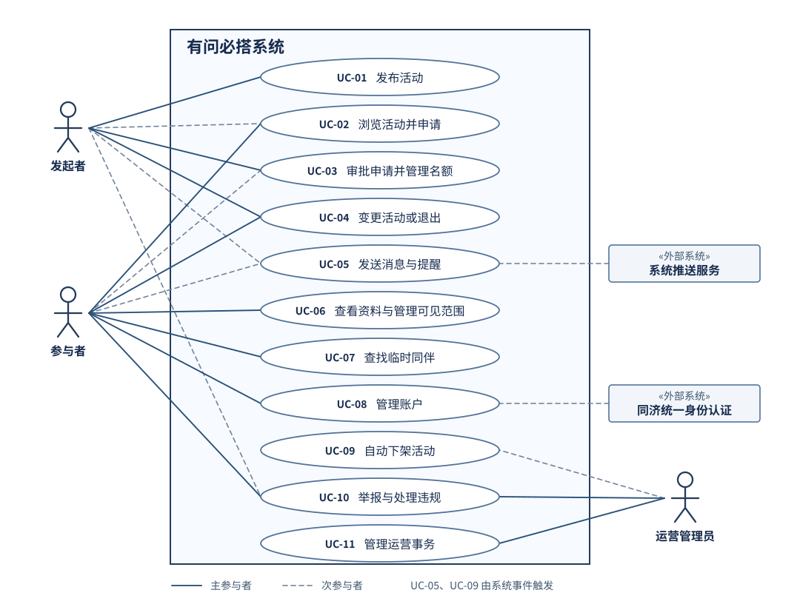

# 有问必“搭”软件需求规格说明书（SRS）

- 版本：v0.6 草稿（待评审）
- 日期：2026-11-27
- 对应课程：第 03 课 · 第 11 周 · SRS 定稿
- 状态：**待课堂评审**
- [修订历史](#change-history)

---

## 1. 引言

### 1.1 目的

本文规定"有问必搭"（Ask.Match）的功能需求、非功能需求与约束条件，作为设计、开发、测试与验收的依据。读者为课程评审教师、开发组成员与测试负责人。

### 1.2 范围

本产品面向**同济大学在校学生**，通过学校统一身份认证准入，解决"**熟人凑不齐、又不想放弃这次活动**"这一具体时刻的找人问题，覆盖发布、发现、申请、确认、变更、通知、资料可见与运营治理八个方面。

**不在范围内**（详见[非目标与边界](非目标与边界.md)）：

- 教职工与校外人员使用（本版仅面向在校学生）
- 约会 / 陌生人配对
- 付费会员与增值订阅
- 自动定位与持续位置共享
- 场地预订、拼车交易等资源撮合（本产品只解决"找到人"，不介入"订资源"）
- 人工全量内容审核

### 1.3 术语与缩写

| 术语 | 含义 |
|---|---|
| 搭子 | 为某次具体活动临时结成的同伴关系，非长期社交关系 |
| 发起者 | 创建活动、审批申请、管理名额的学生 |
| 参与者 | 浏览活动、提交申请、确认参加的学生 |
| 运营管理员 | 由学生担任，负责举报处理与信息治理，无专职人力 |
| 统一身份认证 | 同济大学校园统一身份认证（SSO），用于确认"是在校学生" |
| 会话 | 平台账号的登录有效期，7 天滑动 |
| 登录名 | 用户自设的唯一登录标识，与昵称分离 |
| 报名确认状态 | 已提交 → 已接受 → 已确认。已确认者受活动变更影响时进入待重新确认 |
| EV | 调研证据编号，格式 `EV-S05-Q07` 或 `EV-O01-Q1` |
| US / NFR | 用户故事编号 / 非功能需求编号 |
| UC / TC | 用例编号 / 测试用例编号 |
| P0 / P1 / P2 | 优先级：不做不能答辩 / 本轮要做 / 可选或待验证 |

### 1.4 参考资料

| 文档 | 用途 |
|---|---|
| [调研回答整理（S01–S04）](../调研报告/有问必搭_调研回答整理.md) | 学生访谈证据 |
| [调研回答整理（S05–S09）](../调研报告/有问必搭_调研回答整理_S05-S09.md) | 学生访谈证据 |
| [调研回答整理（S10–S12）](../调研报告/有问必搭_调研回答整理_S10-S12.md) | 方向性佐证（非标准访谈） |
| [运营管理员访谈（O01）](../调研报告/有问必搭_运营管理员访谈记录.md) | 拟任运营者的意见 |
| [用户故事清单](用户故事清单.md) | 功能需求和非功能需求的原始条目 |
| [证据索引](证据索引.md) | 需求与证据编号的双向对应及原文入口 |
| [非目标与边界](非目标与边界.md) | 项目范围、反向证据和风险 |

### 1.5 需求来源与强度

调研材料覆盖 12 位学生（S01–S12）和 1 位拟任运营者（O01）。目标用户为同济大学在校学生。S04 为[上海交通大学学生](../调研报告/有问必搭_调研回答整理.md#s04-上海交通大学大三学生)，作为校外参考样本。S10–S12 的材料用于方向性佐证。

证据强度分三级：

| 强度 | 判定 | 处理 |
|---|---|---|
| 强 | ≥2 位受访者亲身经历 | 可进 P0 |
| 中 | 1 位亲身经历，或角色当事人的明确诉求 | 进 P1/P2 |
| 弱 | 仅建议、设想，无亲身经历 | 打 `假设` 标签，列为待验证 |

当前分布：强 10 条 / 中 12 条 / 弱 3 条。

> 拟任运营者提出了校园身份验证的需求，建议使用学号或校园邮箱。同济统一身份认证由团队选定。详见[运营管理员访谈](../调研报告/有问必搭_运营管理员访谈记录.md)。

---

## 2. 总体描述

### 2.1 产品定位

**补位工具，不是社交扩列工具。**

真实调研的结论是：学生找人首先在熟人圈里找（S05、S06、S07、S08），平台的空位出现在"熟人没空、但自己仍想参加"的那一刻（S01、S05、S09）。因此产品默认从熟人/半熟人切入，不默认开放陌生人社交。

### 2.2 用户特征与干系人

| 干系人 | 特征 | 证据覆盖 |
|---|---|---|
| 参与者（在校学生） | 移动端为主，习惯微信/QQ；对陌生人社交有压力 | S01–S12，充分 |
| 发起者（学生组织者） | 需逐个确认时间地点，反复处理；多为临时组织 | S01、S06、S09 |
| 运营管理员 | 学生兼任，无专职人力；最担心身份真实性与虚假信息 | O01（样本量 1） |
| 付费方 | 仅涉及活动内部 AA 费用，不涉及平台付费 | S12，反向 |

> 本版不设"场地方 / 资源提供方"角色：场地预订、拼车交易等资源撮合不在范围内。

### 2.3 运行环境

- 终端：移动端浏览器优先，桌面端可用
- 网络：面向校园网和移动网络，弱网与断网重试规则见[非功能需求](#nonfunctional-requirements)。
- 通知渠道：站内消息和系统推送，见[外部接口需求](#external-interfaces)。

### 2.4 假设与依赖

1. 注册与密码找回依赖同济统一身份认证，接口状态见[外部接口需求](#external-interfaces)。
2. 用户愿意为平台单独设置一个密码（注册成本增加一步）。
3. 活动通常临时发起，信息更新较快。[信息自动下架](#uc-09)用于保持可招募列表的时效性。
4. 运营需求来自一位拟任运营者，后续验证安排见[待补访与待决项](#open-questions)。

### 2.5 账户准入概述

注册时通过同济统一身份认证验证在校身份，日常使用平台账号登录。账户操作见 [UC-08 管理账户](#uc-08)，会话与数据规则见[安全与隐私](#security-and-privacy)。

---

## 3. 功能需求

### 3.1 用例图

> 实线表示主参与者，虚线表示次参与者。UC-05 和 UC-09 由系统内部事件触发。学生可在不同活动中分别承担参与者和发起者角色。

### 3.2 用例总览

| 用例 | 名称 | 主参与者或触发方式 | 次参与者 |
|---|---|---|---|
| [UC-01](#uc-01) | 发布活动 | 发起者 | — |
| [UC-02](#uc-02) | 浏览活动并申请 | 参与者 | 发起者 |
| [UC-03](#uc-03) | 审批申请并管理名额 | 发起者 | 参与者 |
| [UC-04](#uc-04) | 变更活动或退出 | 参与者、发起者 | — |
| [UC-05](#uc-05) | 发送消息与提醒 | 系统事件触发 | 参与者、发起者、系统推送服务 |
| [UC-06](#uc-06) | 查看资料与管理可见范围 | 参与者 | — |
| [UC-07](#uc-07) | 查找临时同伴 | 参与者 | — |
| [UC-08](#uc-08) | 管理账户 | 参与者 | 同济统一身份认证 |
| [UC-09](#uc-09) | 自动下架活动 | 系统事件触发 | 运营管理员 |
| [UC-10](#uc-10) | 举报与处理违规 | 参与者、运营管理员 | 发起者 |
| [UC-11](#uc-11) | 管理运营事务 | 运营管理员 | — |

需求与用例的对应关系见[追溯矩阵](#traceability-matrix)。

### 3.3 用例描述

#### UC-01 发布活动

| 项 | 内容 |
|---|---|
| 参与者 | 主：发起者 |
| 前置条件 | 发起者已完成注册并处于有效会话内 |
| 触发事件 | 发起者选择发布活动 |
| 基本流程 | 1. 发起者填写活动类型、时间、地点、人数上限、是否 AA 2. 系统校验必填项与时间合理性 3. 活动发布，状态为「招募中」 4. 有可用时段信息时，发起者可查看共同可用时段 |
| 异常流程 | 2a. 时间早于当前，提示修改；人数上限小于 2，提示补充 3a. 会话过期，暂存草稿，重新登录后恢复 |
| 后置条件 | 活动可被检索与申请 |

#### UC-02 浏览活动并申请

| 项 | 内容 |
|---|---|
| 参与者 | 主：参与者；次：发起者 |
| 前置条件 | 用户已登录平台账号 |
| 触发事件 | 用户打开活动列表或通过分享链接进入活动详情 |
| 基本流程 | 1. 用户浏览活动，可按类型、时间、地点和费用条件筛选 2. 系统显示符合条件的活动及剩余名额 3. 用户打开详情，查看时间、地点、人数、费用是否 AA 4. 用户提交申请 5. 系统将申请置为「已提交」，提示尚未确认 6. 系统通知发起者 |
| 异常流程 | 3a. 名额已满时提示候补，相关规则见 [UC-03](#uc-03) 4a. 会话过期，提示重新登录并恢复申请内容 4b. 已保存的申请遇到重复提交或断网后重试，系统返回原记录的当前状态 4c. US-11 涉及报名时的名单冲突提示，提示范围见[待决项](#open-questions) |
| 后置条件 | 申请记录存在且状态为"已提交"；发起者收到通知 |

#### UC-03 审批申请并管理名额

| 项 | 内容 |
|---|---|
| 参与者 | 主：发起者；次：参与者 |
| 前置条件 | 活动与相关申请记录存在 |
| 触发事件 | 发起者打开申请列表，或参与者前往活动详情查看自己的参加状态 |
| 基本流程 | 1. 发起者查看申请者授权公开的资料，以昵称显示身份 2. 发起者接受或拒绝申请 3. 发起者接受后，系统将申请置为「已接受」，预留一个名额 4. 系统通知申请者 5. 申请者确认后，状态变为「已确认」，沿用已预留名额 6. 参与者可以在活动详情查看自己的参加状态和是否仍在名单中。名单冲突提示范围见[待决项](#open-questions) |
| 异常流程 | 3a. 名额已满时，新申请进入候补队列 3b. 并发审批时，系统按 NFR-01 检查名额上限 5a. 活动时间变更时，按 [UC-04](#uc-04) 进入待重新确认 6a. 已确认者退出后，候补第 1 位收到通知并确认是否补位。递补时限见[待决项](#open-questions) |
| 后置条件 | 名单状态与剩余名额一致；所有相关方收到对应通知 |

#### UC-04 变更活动或退出

| 项 | 内容 |
|---|---|
| 参与者 | 主：参与者 / 发起者 |
| 前置条件 | 活动已发布；退出操作由已确认参加的用户发起 |
| 触发事件 | 发起者改期、改地点或取消活动，或参与者退出 |
| 基本流程 | 1. 系统记录发起者对活动的变更或参与者的退出，参与者可自行决定是否填写退出原因 2. 改期或改地点时，系统将受影响的已确认者置为「待重新确认」，并通知这些用户和此前待重新确认且仍在名单中的用户。取消时，系统向相关参与者发送明确的取消通知 3. 系统根据参与情况更新名单与剩余名额 |
| 异常流程 | 3a. 变更导致人数不足，提示发起者判断是否成行（US-13） 3b. 超时未重新确认，从名单中移除 |
| 后置条件 | 名单反映真实安排；相关方收到通知 |

#### UC-05 发送消息与提醒

| 项 | 内容 |
|---|---|
| 参与者 | 次：参与者、发起者、系统推送服务 |
| 前置条件 | 系统可识别与事件相关的接收者 |
| 触发事件 | 申请、接受、变更、取消、补位等业务事件发生，或到达活动提醒时间 |
| 基本流程 | 1. 系统根据触发事件生成通知 2. 生成站内消息，并按用户设置发送系统推送 3. 记录各渠道的发送结果，供发起者判断是否需要换渠道 |
| 异常流程 | 2a. 系统推送失败时重试，仍失败则保留站内消息，并记录该次推送失败。送达验收口径见[待决项](#open-questions) 3a. 用户婉拒时，发送「暂不参加」 |
| 后置条件 | 消息状态可查 |

#### UC-06 查看资料与管理可见范围

| 项 | 内容 |
|---|---|
| 参与者 | 主：参与者 |
| 前置条件 | 处于有效会话内 |
| 触发事件 | 参与者查看资料，或修改、预览自己的可见范围 |
| 基本流程 | 1. 用户设置昵称与各字段在"报名前/确认后"两档的可见范围 2. 用户预览"他人眼中的我" 3. 系统按设置渲染他人视角 4. 系统展示与对方的关系线（共同好友/同社团/同班） |
| 异常流程 | 3a. 未确认状态下请求联系方式，系统不下发该字段（NFR-02） 3b. 会话过期，提示重新登录，受限资料在登录前不可访问 |
| 后置条件 | 可见范围生效，且不突破系统底线 |

#### UC-07 查找临时同伴

| 项 | 内容 |
|---|---|
| 参与者 | 主：参与者 |
| 前置条件 | 处于有效会话内 |
| 触发事件 | 参与者打开临时找伴并选择活动类型 |
| 基本流程 | 1. 用户选择"此刻想去"的活动类型 2. 系统返回同校、同一时间段内也有意向的用户或活动 3. 用户发起或加入 |
| 异常流程 | 2a. 无人响应 → 提示"暂无同伴"，允许自行前往 |
| 后置条件 | 不产生持续位置共享 |

#### UC-08 管理账户

| 项 | 内容 |
|---|---|
| 参与者 | 主：参与者；次：同济统一身份认证 |
| 前置条件 | 注册与找回密码需要可验证的同济在校学生身份。登录需要已有平台账号，修改密码与注销需要有效会话 |
| 触发事件 | 用户选择注册、登录、修改密码、找回密码或注销 |
| 基本流程 | **注册**：通过同济统一身份认证校验在校身份，用学号哈希查重，一个学号只能绑定一个账号。用户设置 4–20 位字母或数字组成的全局唯一登录名、可重复的展示昵称和至少 8 位且包含字母及数字的密码。注册成功后进入登录页 **登录**：用户以登录名和密码登录，验证成功后建立平台会话。界面以昵称展示用户 **改密码**：验证旧密码后更新密码，并使其他会话失效 **找回密码**：重新通过 SSO 验证，匹配学号哈希后重置密码 **注销**：关闭账号并按[安全与隐私](#security-and-privacy)处理资料与认证记录 |
| 异常流程 | 校园认证拒绝、取消或失败时，提示认证未完成，本次注册或密码重置不生效；非同济在校学生注册时拒绝并提示准入条件；学号已绑定时引导找回密码；登录名已占用或密码不符合要求时提示修改；登录失败 5 次锁定 15 分钟；旧密码错误或找回时身份匹配失败则不更新密码 |
| 后置条件 | 系统根据操作创建账户、建立会话、更新密码或关闭账户。认证数据与会话按[安全与隐私](#security-and-privacy)处理 |

#### UC-09 自动下架活动

| 项 | 内容 |
|---|---|
| 参与者 | 次：运营管理员 |
| 前置条件 | 存在已发布活动 |
| 触发事件 | 活动达到预定时间，或活动名额发生变化 |
| 基本流程 | 1. 系统根据活动时间和报名情况检查是否满足下架条件，满员按 [UC-03](#uc-03) 中已预留和已确认的名额计算，同一个申请只占一个名额 2. 满足条件时，更新活动状态并从普通招募列表移除 3. 系统记录下架原因，供运营管理员查阅 |
| 异常流程 | 满员后退出是否恢复招募、过期的判定时点及进行中的列表展示见[待决项](#open-questions) |
| 后置条件 | 列表只展示有效信息 |

#### UC-10 举报与处理违规

| 项 | 内容 |
|---|---|
| 参与者 | 主：参与者 / 运营管理员；次：发起者 |
| 前置条件 | 处于有效会话内 |
| 触发事件 | 用户提交举报或申诉，或运营管理员处理待办 |
| 基本流程 | 1. 用户对虚假信息、广告或爽约行为提交举报 2. 系统生成待处理项，通知运营者 3. 运营者核实（查看证据、询问双方） 4. 按情节分级处置：提醒 → 警告 → 限制 5. 被处置方可申诉，运营者复核 |
| 异常流程 | 1a. 会话过期，保留草稿，重新登录后提交 4a. 情节轻微且有正当理由，仅提醒且不计次 5a. 申诉成立，撤销处置并记录 |
| 后置条件 | 处置记录可查，申诉通道可达 |

#### UC-11 管理运营事务

| 项 | 内容 |
|---|---|
| 参与者 | 主：运营管理员 |
| 前置条件 | 具备运营权限 |
| 触发事件 | 运营管理员打开后台 |
| 基本流程 | 1. 运营者登录后台 2. 查看用户列表（仅昵称与脱敏信息）、举报队列、匹配情况 3. 处理举报、下架违规信息 4. 查看完整联系方式需二次授权，操作留痕 |
| 异常流程 | 2a. 越权访问 → 拒绝并记审计日志 2b. 请求学号或姓名原文 → 系统无此数据，返回不可用 |
| 后置条件 | 所有敏感操作可审计 |

### 3.4 功能需求条目

完整故事见[用户故事清单](用户故事清单.md)，对应的用例见[追溯矩阵](#traceability-matrix)，验收标准的维护方式见[验收说明](#acceptance)。

| 编号 | 名称 | 优先级 |
|---|---|---|
| US-01 | 熟人没空时看到同校还有谁想参加 | P0 |
| US-02 | 发布活动 | P0 |
| US-03 | 决定前看到申请者基本资料 | P0 |
| US-04 | 按类型/时间/地点/费用筛选 | P2 |
| US-05 | 一次看到共同可用时段 | P0 |
| US-06 | 时间地点变更时收到通知 | P0 |
| US-07 | 随时看到自己是否还在名单 | P1 |
| US-08 | 已提交 / 已接受 / 已确认三态可见 | P0 |
| US-09 | 满员转候补并按顺序递补 | P1 |
| US-10 | 候补者确认补位 | P1 |
| US-11 | 提示"名单里有不想见的人" | P2 |
| US-12 | 变化时快速退出 | P0 |
| US-13 | 退出后看到"是否成行" | P1 |
| US-14 | 取消或改期的明确通知 | P0 |
| US-15 | 知道申请是否已送达 | P0 |
| US-16 | 婉拒而不必拉黑 | P2 |
| US-17 | 活动前提醒 | P1 |
| US-18 | 控制各字段可见范围 | P1 |
| US-19 | 看到与对方的关系线 | P1 |
| US-20 | 此刻同校有谁也想去 | P2 |
| US-21 | 注册时校内认证 + 平台账号登录 | P1 |
| US-22 | 过期或满员自动下架 | P1 |
| US-23 | 举报虚假信息 / 广告 / 爽约 | P1 |
| US-24 | 统一管理后台 | P2 |
| US-25 | 多次爽约分级处置与申诉 | P2 |

---

## 4. 非功能需求

### 4.1 性能

| 编号 | 要求 | 验收标准 |
|---|---|---|
| NFR-01 | 报名响应时间与名额上限 | **响应时间**。同一活动剩 10 个名额，在记录了测试环境的条件下，200 名用户并发提交申请，至少 95% 的请求在 2 秒内返回。 **名额上限**。对同一批申请并发审批并随后确认，本轮累计预留或确认的名额不超过剩余的 10 个。每份从「已接受」转为「已确认」的申请只占一个名额。 |

### 4.2 安全与隐私

| 编号 | 要求 | 验收标准 |
|---|---|---|
| NFR-02 | 保护联系方式、账户凭证和认证数据，限制平台会话有效期 | 参加确认前，通过页面、搜索或接口请求对方资料时，响应不含联系方式。运营管理员访问完整联系方式须二次授权并留审计记录 检查账户记录，密码仅以 Argon2id 加盐哈希存储。认证数据仅保留学号哈希，用于查重与找回密码。学号、姓名、院系、邮箱的认证原文不持久化 平台会话使用平台签发的 Cookie，设置 `HttpOnly`、`Secure`、`SameSite`，按 7 天滑动过期。修改密码后，其他会话应失效 注销后，系统清空该账号的昵称、资料和活动记录，保留学号哈希用于限制注销后重注册 |

### 4.3 可用性

| 编号 | 要求 | 验收标准 |
|---|---|---|
| NFR-03 | 断网重试不重复，登录过期后恢复内容 | 同一申请保存成功但响应丢失时，用户联网后重试可查到原申请的当前状态，系统只保留一条申请记录。若申请已被审批，重试后仍显示最新状态。发布、申请或举报表单遇到登录过期时，用户重新登录后可恢复该次已填写的数据。 |
| NFR-04 | 临近开始的活动变更通知可达 | **建议验收口径，待评审。** 旧或新开始时间任一落在未来 2 小时内时，从变更保存成功计时，受影响用户在 60 秒内可在站内查询本次通知。对已授权推送、设备在线且推送通道正常的用户，以测试设备在 60 秒内实际收到推送为准。推送失败可追踪和重试，站内通知仍可查询。触发窗口和失败验收细则见[待决项](#open-questions)。 |

> NFR-01 的 200 并发指标由团队从课堂示例引入，正式验收时记录测试环境、统计口径和实测结果。NFR-04 保留 60 秒目标，分渠道的验收条件参考 [NFR-04 Issue](https://github.com/regretofice/Ask.Match/issues/36)。

---

## 5. 外部接口需求

| 接口 | 说明 | 状态 |
|---|---|---|
| 同济大学统一身份认证（SSO） | 注册时验证在校身份，找回密码时重新验证身份。验证结果用于确认资格和匹配学号哈希，处理过程见 [UC-08](#uc-08) | 可接入，待对接 |
| 系统推送服务 | 为[消息与提醒](#uc-05)提供推送能力，站内消息由平台处理 | 待选型 |

平台登录使用[平台账号](#uc-08)。

---

## 6. 约束条件

| 编号 | 约束 | 来源或关联 |
|---|---|---|
| C-01 | 由学生负责运营，治理流程须能以少量人工维护 | [运营管理员访谈](../调研报告/有问必搭_运营管理员访谈记录.md) O01-Q3 |
| C-02 | 校园身份通过同济统一身份认证验证 | [外部接口需求](#external-interfaces) |
| C-03 | 课程周期内交付，首版优先完成 P0 需求 | 课程安排 |
| C-04 | 日常治理采用信息自动下架与举报处理 | [非目标与边界](非目标与边界.md) NG-05 |
| C-05 | 违规处置按情节分级，并提供申诉渠道 | [非目标与边界](非目标与边界.md) NG-07 |
| C-06 | 注册仅面向同济大学在校学生 | [产品范围](#product-scope) |
| C-07 | 认证数据与密码的持久化遵守 NFR-02 | [安全与隐私](#security-and-privacy) |
| C-08 | 场景限于学习、运动、出行、聚餐等公开校园活动。学生账号可承担发起者或参与者角色。一对一私聊和位置追踪列为范围约束，临时找伴使用同校和时间段信息 | [产品范围](#product-scope)、[非目标与边界](非目标与边界.md)、[临时找伴](#uc-07) |
| C-09 | 由平台独立维护登录会话 | [安全与隐私](#security-and-privacy) |

---

## 7. 追溯与验收

### 7.1 追溯矩阵（v0）

本表覆盖 25 条功能需求和 4 条非功能需求。点击需求编号可查看对应 GitHub Issue 的说明和验收条目，点击用例编号可跳到用例描述。证据编号及原文入口见[证据索引](证据索引.md)。

| 需求 | 用例 | 测试用例 | 证据 |
|---|---|---|---|
| [US-01](https://github.com/regretofice/Ask.Match/issues/19) | [UC-02](#uc-02) | — | EV-S05-Q03、EV-S09-Q12、EV-S11-Q03 |
| [US-02](https://github.com/regretofice/Ask.Match/issues/20) | [UC-01](#uc-01) | — | EV-S06-Q12、EV-S09-Q02、EV-S10-Q11 |
| [US-03](https://github.com/regretofice/Ask.Match/issues/21) | [UC-03](#uc-03)、[UC-06](#uc-06) | — | EV-S01-Q09、EV-S09-Q09、EV-S03-Q09 |
| [US-04](https://github.com/regretofice/Ask.Match/issues/22) | [UC-02](#uc-02) | — | EV-S11-Q03、EV-S10-Q01 为方向性证据，筛选需求待验证 |
| [US-05](https://github.com/regretofice/Ask.Match/issues/9) | [UC-01](#uc-01) | — | EV-S01-Q04、EV-S04-Q11、EV-S06-Q04 |
| [US-06](https://github.com/regretofice/Ask.Match/issues/11) | [UC-04](#uc-04)、[UC-05](#uc-05) | — | EV-S06-Q04、EV-S07-Q08、EV-S08-Q08 |
| [US-07](https://github.com/regretofice/Ask.Match/issues/12) | [UC-02](#uc-02)、[UC-03](#uc-03) | — | EV-S01-Q07、EV-S05-Q07、EV-S09-Q07 |
| [US-08](https://github.com/regretofice/Ask.Match/issues/28) | [UC-02](#uc-02)、[UC-03](#uc-03)、[UC-04](#uc-04) | — | EV-S05-Q07、EV-S06-Q07、EV-S09-Q07、EV-S01-S04-归纳2 |
| [US-09](https://github.com/regretofice/Ask.Match/issues/29) | [UC-03](#uc-03) | — | EV-S06-补充-S02、EV-S01-Q08 |
| [US-10](https://github.com/regretofice/Ask.Match/issues/30) | [UC-03](#uc-03) | — | EV-S06-补充-S02、EV-S09-Q08 |
| [US-11](https://github.com/regretofice/Ask.Match/issues/31) | [UC-02](#uc-02)、[UC-03](#uc-03) | — | EV-S05-补充、EV-S09-补充 |
| [US-12](https://github.com/regretofice/Ask.Match/issues/8) | [UC-04](#uc-04) | — | EV-S01-Q08、EV-S09-Q08 |
| [US-13](https://github.com/regretofice/Ask.Match/issues/10) | [UC-04](#uc-04) | — | EV-S05-Q08、EV-S09-Q08 |
| [US-14](https://github.com/regretofice/Ask.Match/issues/14) | [UC-04](#uc-04)、[UC-05](#uc-05) | — | EV-S06-Q04、EV-S08-Q08、EV-S04-Q08 |
| [US-15](https://github.com/regretofice/Ask.Match/issues/24) | [UC-02](#uc-02)、[UC-03](#uc-03)、[UC-05](#uc-05) | — | EV-S05-Q10、EV-S05-Q11、EV-S07-Q11、EV-S08-Q10 |
| [US-16](https://github.com/regretofice/Ask.Match/issues/25) | [UC-05](#uc-05) | — | EV-S05-补充、[EV-S06-补充](../调研报告/有问必搭_调研回答整理_S05-S09.md#s06-线上会议受访者) |
| [US-17](https://github.com/regretofice/Ask.Match/issues/26) | [UC-05](#uc-05) | — | EV-S06-Q04、[EV-S08-Q07](../调研报告/有问必搭_调研回答整理_S05-S09.md#s08-线上会议受访者) |
| [US-18](https://github.com/regretofice/Ask.Match/issues/16) | [UC-06](#uc-06) | — | EV-S03-Q09、EV-S09-Q09、[EV-S08-Q09](../调研报告/有问必搭_调研回答整理_S05-S09.md#s08-线上会议受访者) |
| [US-19](https://github.com/regretofice/Ask.Match/issues/17) | [UC-06](#uc-06) | — | EV-S05-Q06、EV-S05-Q09、EV-S06-Q09、EV-S07-Q12 |
| [US-20](https://github.com/regretofice/Ask.Match/issues/13) | [UC-07](#uc-07) | — | EV-S12-Q03、EV-S12-Q11，方向性佐证 |
| [US-21](https://github.com/regretofice/Ask.Match/issues/23) | [UC-08](#uc-08) | — | EV-O01-Q1，统一身份认证由团队选定 |
| [US-22](https://github.com/regretofice/Ask.Match/issues/15) | [UC-03](#uc-03)、[UC-09](#uc-09) | — | EV-O01-Q3 |
| [US-23](https://github.com/regretofice/Ask.Match/issues/27) | [UC-10](#uc-10)、[UC-11](#uc-11) | — | EV-O01-Q2 |
| [US-24](https://github.com/regretofice/Ask.Match/issues/18) | [UC-11](#uc-11) | — | EV-O01-Q3 |
| [US-25](https://github.com/regretofice/Ask.Match/issues/32) | [UC-10](#uc-10) | — | EV-O01-Q2 |
| [NFR-01](https://github.com/regretofice/Ask.Match/issues/33) | [UC-02](#uc-02)、[UC-03](#uc-03) | — | EV-S06-补充-S02，性能指标由团队设定 |
| [NFR-02](https://github.com/regretofice/Ask.Match/issues/34) | [UC-06](#uc-06)、[UC-08](#uc-08)、[UC-11](#uc-11) | — | EV-S03-Q09、EV-S09-Q09、EV-O01-Q1，安全措施由团队设定 |
| [NFR-03](https://github.com/regretofice/Ask.Match/issues/35) | [UC-01](#uc-01)、[UC-02](#uc-02)、[UC-03](#uc-03)、[UC-08](#uc-08)、[UC-10](#uc-10) | — | EV-S05-Q10，重试与草稿恢复规则由团队设定 |
| [NFR-04](https://github.com/regretofice/Ask.Match/issues/36) | [UC-04](#uc-04)、[UC-05](#uc-05) | — | EV-S06-Q04、[EV-S08-Q07](../调研报告/有问必搭_调研回答整理_S05-S09.md#s08-线上会议受访者)，时限由团队设定 |

测试用例列在测试设计阶段补入 `TC-xx` 编号。

### 7.2 验收说明

功能验收标准按需求编号维护在对应 GitHub Issue 中，格式见 [Issue 填写模板](Issue填写模板.md)。非功能验收标准见[第 4 章](#nonfunctional-requirements)。评审时可从[追溯矩阵](#traceability-matrix)进入用例，核对前置条件、操作和预期结果。

课堂可重点讲 [UC-02 浏览活动并申请](#uc-02) 和 [UC-08 管理账户](#uc-08)。两个用例均包含触发事件、基本流程、异常流程和后置条件。以下标准可直接用于评审：

| 用例 | 前提与操作 | 预期结果 |
|---|---|---|
| UC-02 正常流程 | 已登录的学生打开可报名活动并提交申请 | 生成一条「已提交」申请，详情显示尚未确认，发起者收到待处理通知 |
| UC-02 异常流程 | 申请已保存，因断网丢失响应，用户联网后重试 | 仍只有一条申请，详情显示当前状态 |
| UC-08 正常流程 | 同济在校学生通过 SSO 验证并填写符合规则的登录名、昵称和密码 | 平台建立账号。此后可用该登录名和密码进入平台会话 |
| UC-08 异常流程 | 用户取消校园认证，或认证结果未证明其为同济在校学生 | 平台显示相应提示，账号未创建 |

以 **US-08 报名状态可见**为例：

| 前提与操作 | 预期结果 |
|---|---|
| 参与者提交申请，发起者尚未处理 | 活动详情显示「已提交」 |
| 发起者接受申请，申请者尚未确认 | 活动详情显示「已接受」，申请者可以确认参加 |
| 申请者确认参加 | 活动详情显示「已确认」，名单反映该参与者已确认 |
| 已确认后活动改期，参与者尚未重新确认 | 活动详情显示「待重新确认」 |

---

## 8. 附录

### 8.1 弱证据条目（待验证）

| 编号 | 内容 | 为什么弱 |
|---|---|---|
| US-04 | 按条件筛选 | 仅建议与观察，无筛选行为的亲身经历 |
| US-11 | 提示"有不想见的人" | 两位受访者的设想，未在真实场景使用；S05 自述"拉黑不太好" |
| US-16 | 婉拒而不拉黑 | 同上，属设想 |

### 8.2 被否的想法

相关访谈和处理见[非目标与边界](非目标与边界.md)第二节。S07 表示熟人圈通常不缺人，S08 平时不会用，特别合适时才会看一眼，S11 质疑与校园墙的功能重合，S03 更偏好与熟悉的人同行。

### 8.3 待补访与待决项

1. 运营管理员：争取 1 位真实运营过的人复核（现仅 O01 设想）。
2. 候补时限、已读形式、黑名单提醒范围：三处回答不一致，需复核。
3. S10–S12：非标准访谈，需回访核对。
4. 名额与下架：[审批](#uc-03)与[自动下架](#uc-09)采用同一名额口径。待确认已接受未确认、待重新确认的名额保留时限，满员后的候补入口，以及各活动阶段在列表中的展示。
5. 取消与通知：[UC-04](#uc-04) 已纳入取消通知。取消后各类报名状态的处理、NFR-04 的两小时窗口以旧时间还是新时间为准、推送重试条件，待结合 [NFR-04 Issue](https://github.com/regretofice/Ask.Match/issues/36)评审确认。
6. 关系线：[UC-06](#uc-06) 涉及共同好友、同班或同社团。信息从何处取得、可以向谁展示，均待确认。若由校内业务系统提供且确认接入，再补充对应的外部接口和参与者。

### 8.4 账户方案说明

平台账号用于支持日常登录并减少跳转校园认证。校园认证用于注册验证和密码找回。选择独立账号后，平台负责密码校验、失败锁定、会话管理及认证数据保护，详见 [UC-08](#uc-08) 和[安全与隐私](#security-and-privacy)。

### 8.5 课程检查点

| 检查项 | 核对入口 |
|---|---|
| 需求 Issue 的覆盖、标签、负责人及证据链接 | [仓库配置与分工](仓库配置与分工.md)、[用户故事清单](用户故事清单.md)、[证据索引](证据索引.md) |
| 用例图的主、次参与者 | [用例总览](#use-case-overview) |
| 需求 ID 与用例编号的对应关系 | [追溯矩阵](#traceability-matrix) |
| SRS v1.0 发布与变更记录 | [修订历史](#change-history) |

---

## 9. 变更记录

| 日期 | 版本 | 变更 | 修订人 |
|---|---|---|---|
| 2026-11-25 | v0.1 | 初稿，包含 11 个用例、29 条功能及非功能需求和追溯矩阵雏形 | 组长 |
| 2026-11-25 | v0.2 | 删除场地方角色；认证改为同济统一身份认证 | 组长 |
| 2026-11-25 | v0.3 | 范围收窄为在校学生；新增身份与会话模型；认证数据不落库；会话 2 小时 | 组长 |
| 2026-11-25 | v0.4 | 账户模型改为注册时一次性校内认证 + 平台账号；密码 Argon2id；会话 7 天滑动 | 组长 |
| 2026-11-25 | v0.5 | 登录名与昵称分离；注销保留哈希清空资料；支持改密码 | 组长 |
| 2026-11-27 | v0.6 | 重绘 UML 用例图并标明外部系统，补齐 29 条需求的追溯关系和跳转链接，统一报名状态与名额规则，补充场景验收示例及非功能需求验收条件 | 马锦浩 |

需求变更通过 GitHub Issue 记录理由与影响，再通过 Pull Request 更新 SRS 和相关验收标准。具体流程见[仓库配置与分工](仓库配置与分工.md)。
